

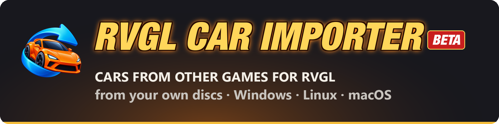

  
  
  
  
  

<b>Your own game disc in, RVGL cars out.</b> 
Read the disc, browse its cars, see each one exactly as RVGL will draw it, export it in one click.

  <a href="#-download"><b>Download</b></a> ·
  <a href="#-what-it-does"><b>What it does</b></a> ·
  <a href="#-supported-games"><b>Games</b></a> ·
  <a href="#-a-tour-of-the-app"><b>Tour</b></a> ·
  <a href="#-reporting-a-problem"><b>Report</b></a> ·
  <a href="#-faq"><b>FAQ</b></a>

## 🏁 What it does

<table>
  <tr>
    <td align="center" width="33%"><h3>💿 1. Open your disc</h3>A disc image (<code>.cue</code>/<code>.bin</code>, <code>.iso</code>, <code>.img</code>), the CD in the drive or a folder of the disc's files. The app ships no game data.</td>
    <td align="center" width="33%"><h3>🔍 2. Pick a car</h3>Every car on the disc, each in every version and colour the game has: <b>over 1,100 cars</b> from the supported games.</td>
    <td align="center" width="33%"><h3>🏎️ 3. Export to RVGL</h3>Body, colours, wheels, handling, engine sound, horn and the car's box in RVGL's menu, straight into its <code>cars</code> folder.</td>
  </tr>
</table>

## 🎮 Supported games

Fifteen games: Gran Turismo 2 and the fourteen added since the first release.

<table>
  <tr>
    <td width="33%" valign="top">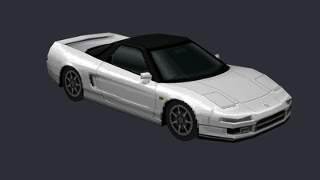<h3>Gran Turismo 2</h3>PlayStation · disc 2 · PAL, Japanese, USA v1.0, v1.1, v1.2  
      <b>608 cars</b> and <b>1,022 versions</b> on the PAL disc: road cars, racing modifications, JGTC GT500, Le Mans and rally cars.
      <ul>
        <li>every colour, with its name from the disc</li>
        <li><b>top speed and acceleration from the game</b>: each car's own run in Gran Turismo 2, laid over RVGL's own cars; handling as Gran Turismo's cars', the engine the game's own at rest</li>
        <li><b>checked against the game</b>: 1,010 of the 1,043 versions (across the five discs) are marked <b>Verified</b>; the other 33 stay <b>Under study</b>, with small differences from the game</li>
      </ul></td>
    <td width="33%" valign="top">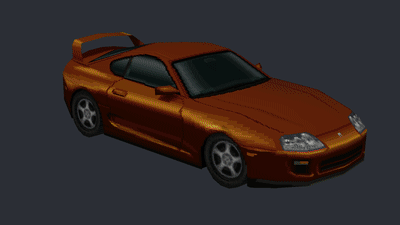<h3>Gran Turismo</h3>PlayStation · PAL, Japanese, USA v1.0, v1.1  
      <b>178 cars</b> and <b>159 Racing Modifications</b>: <b>337 versions</b> on the PAL and USA discs, 333 on the Japanese.
      <ul>
        <li>every dealer colour as a skin, named after the game's own colour</li>
        <li>each car as the game shows it in a race: its model and paint, the pop-up lamps closed</li>
        <li>the game's own engine at rest, and the dealer's sheet: drivetrain, power, torque, weight, size, wheelbase and price</li>
        <li>top speed and acceleration from the real car</li>
      </ul></td>
    <td width="33%" valign="top">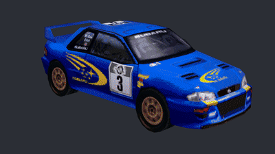<h3>Colin McRae Rally</h3>PlayStation · Europe SLES-00477, USA SCUS-94474  
      <b>12 cars</b> (11 on the American disc, which has no Mégane), from the Escort WRC to the Impreza WRC.
      <ul>
        <li>each car's model, textures and rims, its glass and tyres checked against the game's dry stages</li>
        <li>both engine loops as the game sounds them at rest</li>
        <li>the frontend's sheet: power, wheelbase, drivetrain</li>
      </ul></td>
  </tr>
  <tr>
    <td width="33%" valign="top">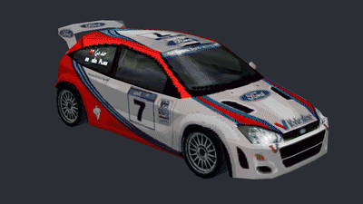<h3>Colin McRae Rally 2.0</h3>PlayStation · Europe SLES-02605, USA SLUS-01222  
      <b>14 cars</b>; the alternate liveries of the Focus 1999, the Lancer and the Integrale are skins of their car.
      <ul>
        <li>each car as the game draws it at rest: clean windows, half-transparent glass in opaque frames, the brake lamps off, the plates and decals over the body</li>
        <li>the game's own engine at rest</li>
        <li>the car selection's sheet: drivetrain and the power and weight bars</li>
      </ul></td>
    <td width="33%" valign="top">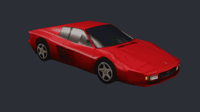<h3>The Need for Speed</h3>PlayStation · Europe SLES-00223, USA SLUS-00204  
      <b>9 drivable cars</b>, the bonus Warrior among them, each with <b>both its liveries</b> as skins.
      <ul>
        <li>each car as the game draws it, the thin parts and the wheels included</li>
        <li>the game's own engine at rest and <b>its own horn</b></li>
        <li>the game's Road &amp; Track sheet</li>
      </ul></td>
    <td width="33%" valign="top">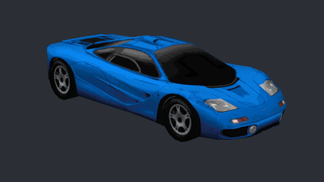<h3>Need for Speed II</h3>PlayStation · Europe SLES-00658, USA SLUS-00276  
      <b>9 cars</b>: the eight of the car selection in <b>all 15 colours</b> of the game's menu, and the bonus Ford Indigo.
      <ul>
        <li>each car as the game draws it, the wheels inside their arches and the tail lamps as the game lights them</li>
        <li>the game's own engine at rest and <b>its own horn</b></li>
        <li>the game's sheet</li>
      </ul></td>
  </tr>
  <tr>
    <td width="33%" valign="top">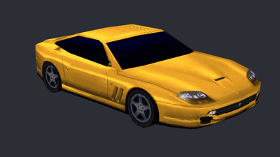<h3>Need for Speed III: Hot Pursuit</h3>PlayStation · Europe SLES-01154, USA SLUS-00620  
      <b>9 cars</b>: the eight real cars and the bonus El Niño, <b>every colour</b> of the car selection as a skin.
      <ul>
        <li>each car as the game's car selection shows it, the lamps whole and the pop-up headlamps closed</li>
        <li>the game's own engine at rest and <b>its own horn</b></li>
        <li>the game's sheet</li>
      </ul></td>
    <td width="33%" valign="top">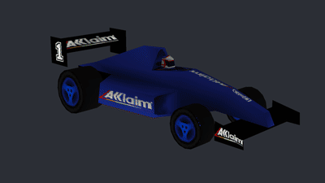<h3>RC Revenge</h3>PlayStation · USA SLUS-01168  
      All <b>15 cars</b>, from Badd RC to the UFO, as the game draws them.
      <ul>
        <li><b>the game's own handling</b>: the physics is read from the game and brought to RVGL, so each car drives as it does in RC Revenge</li>
        <li>each car's own engine sound and horn, and the RC antenna where the game mounts it</li>
        <li>the UFO flies as Re-Volt's Probe UFO</li>
      </ul></td>
    <td width="33%" valign="top">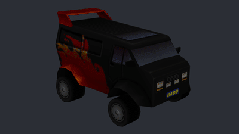<h3>RC Revenge Pro</h3>PlayStation 2 · USA SLUS-20153  
      All <b>19 cars</b> in both their liveries: <b>38 versions</b>, from Badd RC Pro to Zany Zoomer Pro 2.
      <ul>
        <li><b>the game's own physics</b>, read from the game and brought to RVGL</li>
        <li>each car's own engine sound and horn, at the console's own rate</li>
        <li>the RC antenna, the see-through glass and Big Rock's dump bed</li>
      </ul></td>
  </tr>
</table>

<table>
  <tr>
    <td width="33%" valign="top">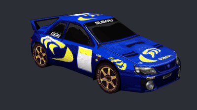<h3>Need for Speed: V-Rally</h3>PlayStation · USA SLUS-00590  
      All <b>11 cars</b>: the six kit cars and the five WRC and Maxi cars.
      <ul>
        <li>each car as the game draws it, the wheels where the game draws them in its Championship</li>
        <li>the game's own engine at rest</li>
      </ul></td>
    <td width="33%" valign="top">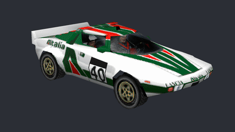<h3>Need for Speed: V-Rally 2</h3>PlayStation · USA SLUS-01003  
      All <b>26 cars</b>: eight WRC, five Kit Cars, three 1.6 L and ten Classics, from the Lancer Evolution to the Stratos HF.
      <ul>
        <li>each car as the game draws it</li>
        <li>the game's own engine at rest</li>
      </ul></td>
    <td width="33%" valign="top">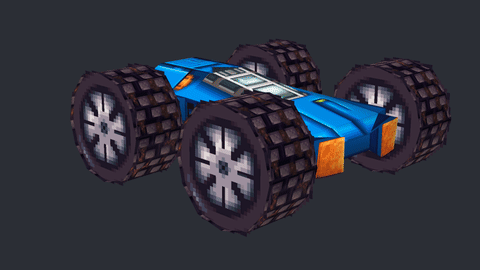<h3>Rollcage</h3>PlayStation · USA SLUS-00800  
      All <b>7 cars</b>, one per driver.
      <ul>
        <li>the race's tail lights and exhaust glow as they burn at rest</li>
        <li>at RVGL's size, <b>driving on their roof as on their wheels</b>, as in the game</li>
        <li>the game's own engine at rest and <b>each driver's own horn</b></li>
        <li>top speed and acceleration from each car's own runs in the game</li>
      </ul></td>
  </tr>
  <tr>
    <td width="33%" valign="top">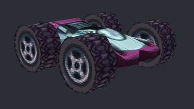<h3>Rollcage Stage II</h3>PlayStation · USA SLUS-00867  
      All <b>20 cars</b> with their Type I, II and III liveries as skins, and Knight Type I and Claw Fist Type III as cars of their own: <b>22 versions</b>.
      <ul>
        <li>the race's tail lights and flares as they burn at rest</li>
        <li>at RVGL's size, <b>driving on their roof as on their wheels</b></li>
        <li>each car's own engine at rest</li>
        <li>top speed and acceleration from each car's own runs in the game</li>
      </ul></td>
    <td width="33%" valign="top">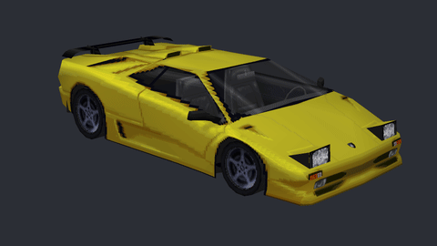<h3>Need for Speed: High Stakes</h3>PlayStation · USA SLUS-00826, Europe (Road Challenge) SLES-01788, SLES-01789  
      All <b>30 cars</b>: the 16 the player buys and wins and the 14 police cars of Hot Pursuit.
      <ul>
        <li>a skin for every colour of the car selection</li>
        <li>the game's own engine and <b>its own horn</b></li>
      </ul></td>
    <td width="33%" valign="top">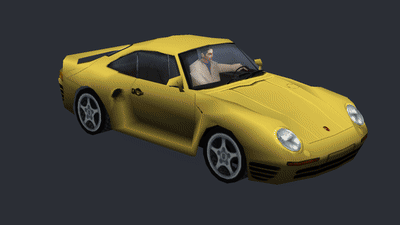<h3>Need for Speed: Porsche Unleashed</h3>PlayStation · USA SLUS-01104, Europe (Porsche 2000) SLES-02689, SLES-02700  
      <b>222 cars</b>: every Porsche of the game, each body at every stage of its Evolution, its hood-up twin in the same family.
      <ul>
        <li>the game's 16 paints as skins</li>
        <li>the game's own engine and <b>its own horn</b></li>
      </ul></td>
  </tr>
</table>

On Gran Turismo, Colin McRae Rally, Colin McRae Rally 2.0, the two V-Rally games and the five Need for Speed games, each car's top speed and acceleration in RVGL follow the real car's published top speed and 0-100 km/h, laid over RVGL's own cars so its rating follows the real car (Gran Turismo 2 takes them from the game instead, the two Rollcage games from each car's runs in the game), and in RVGL's races the car holds the road like RVGL's own cars of its class. The cars of Gran Turismo, the two Colin McRae Rally games and the first three Need for Speed games have round tyres around the game's own rims, and the RC antenna option mounts RVGL's own on them. Every car of the fourteen added games is marked **Verified**.

More games are to come.

## 🎬 A tour of the app

<table>
  <tr>
    <td width="50%">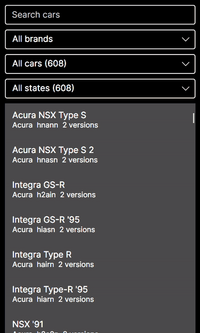</td>
    <td width="50%"><h3>Find any car</h3>Search by name, filter by brand, kind or state. Each car lists its versions; race cars carry their badge.</td>
  </tr>
  <tr>
    <td width="50%"><h3>See it as RVGL draws it</h3>A real-time viewer with RVGL's own look: drag to rotate, right-drag to move, wheel to zoom, double-click to reset.</td>
    <td width="50%">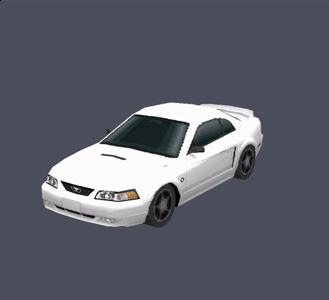</td>
  </tr>
  <tr>
    <td width="50%">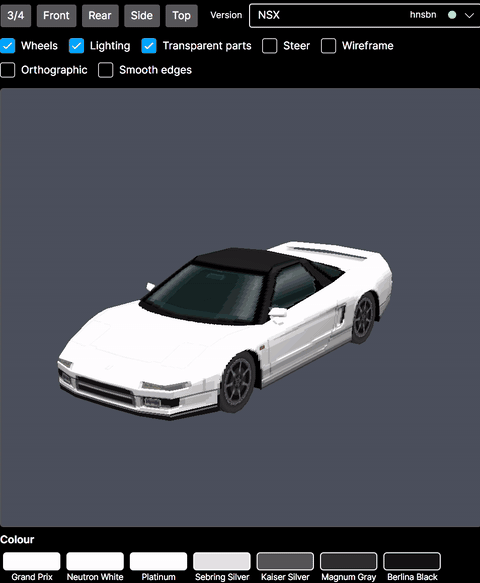</td>
    <td width="50%"><h3>Every angle</h3>Three-quarter, front, rear, side and top in one click.</td>
  </tr>
  <tr>
    <td width="50%"><h3>Every colour</h3>All of a car's colours, with their names from the disc where the game has them; export them all or just one.</td>
    <td width="50%">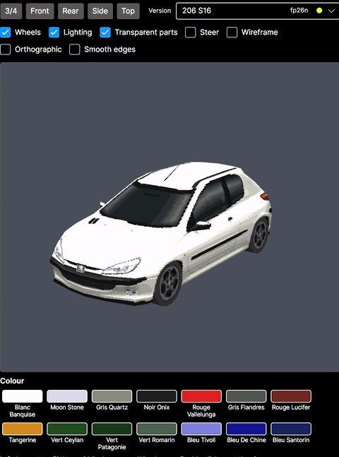</td>
  </tr>
  <tr>
    <td width="50%">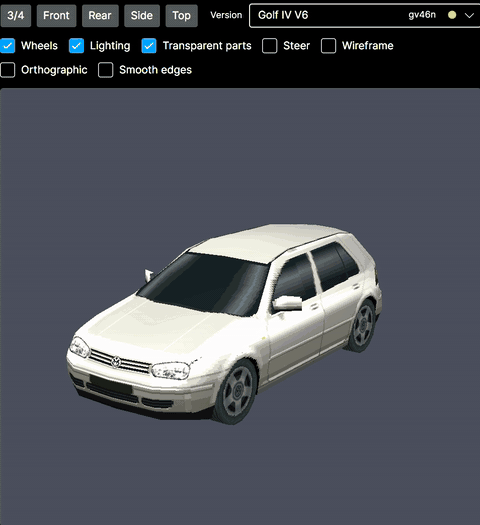</td>
    <td width="50%"><h3>Wireframe, lights, wheels</h3>Check every car before it races: wireframe, lighting, wheels, transparent parts, steering, orthographic view.</td>
  </tr>
  <tr>
    <td width="50%"><h3>Race cars too</h3>Gran Turismo 2's JGTC GT500, Le Mans and rally cars, each with RVGL's rating and stats bars shown as RVGL's car selection will show them.</td>
    <td width="50%">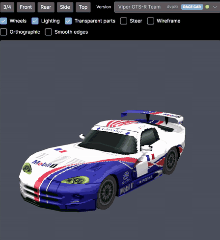</td>
  </tr>
  <tr>
    <td width="50%">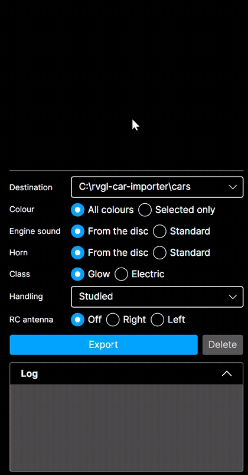</td>
    <td width="50%"><h3>One-click export</h3>Choose the destination, the colours, the engine sound and the horn (from the disc or RVGL's standard), the class, the handling and the RC antenna; <b>Export</b> writes the car, the log tells you where.  <b>Handling</b>: the physics studied for the car, or the handling of any of the 49 original cars of Re-Volt and RVGL found in your RVGL, each shown in a picture; the car keeps its own body and wheels.</td>
  </tr>
</table>

## 📦 Download

No installer and nothing else to install: download the one file for your system and run it. Every file is in the [latest release](https://github.com/6up3r/rvgl-car-importer-releases/releases/latest).

| Your system | Download | First start |
| --- | --- | --- |
| **Windows 11**, or Windows 10 LTSC/Enterprise, 64-bit | [**win-x64.exe**](https://github.com/6up3r/rvgl-car-importer-releases/releases/latest/download/rvgl-car-importer-win-x64.exe) | If SmartScreen shows «Windows protected your PC», click **More info**, then **Run anyway** |
| **Windows 10 LTSC/Enterprise**, 32-bit | [**win-x86.exe**](https://github.com/6up3r/rvgl-car-importer-releases/releases/latest/download/rvgl-car-importer-win-x86.exe) | The same |
| **Windows 11 on ARM** | [**win-arm64.exe**](https://github.com/6up3r/rvgl-car-importer-releases/releases/latest/download/rvgl-car-importer-win-arm64.exe) | The same |
| **Linux**, x64 | [**linux-x64.AppImage**](https://github.com/6up3r/rvgl-car-importer-releases/releases/latest/download/rvgl-car-importer-linux-x64.AppImage) | Make it executable (`chmod +x`), then run it |
| **macOS 14+**, Apple Silicon | [**osx-arm64.zip**](https://github.com/6up3r/rvgl-car-importer-releases/releases/latest/download/rvgl-car-importer-osx-arm64.zip) | Unzip and open `RVGL Car Importer.app`. The app is not notarized, so macOS blocks it once: go to System Settings > Privacy & Security and click **Open Anyway** |
| **macOS 14+**, Intel | [**osx-x64.zip**](https://github.com/6up3r/rvgl-car-importer-releases/releases/latest/download/rvgl-car-importer-osx-x64.zip) | The same |

<b>Not sure which file you need?</b>

 

- **Windows**: Settings > System > About, «System type». «64-bit operating system, x64-based processor» takes `win-x64`, «32-bit operating system» `win-x86`, «ARM-based processor» `win-arm64`.
- **macOS**: Apple menu > About This Mac. «Chip: Apple M…» takes `osx-arm64`, «Processor: Intel» takes `osx-x64`.

<b>What Linux needs</b>

 

The libraries .NET lists for self-contained apps, which desktop distributions usually have already: `libc6`, `libgcc-s1`, `libstdc++6`, `libssl3`, `ca-certificates`, `tzdata`, `zlib1g`, `libgssapi-krb5-2`. Then X11 for the window and FUSE to mount the AppImage. Without FUSE, start it with `--appimage-extract-and-run`.

> [!TIP]
> The app updates itself: at start and from **File > Check for updates...** it looks for a newer release here, and after an update it shows once what is new (**? > What's new...** at any time). It installs a file only if its SHA-256 is listed in the release's `release.json`, signed with the authors' key (`release.json.sig`).

## 🛠️ Reporting a problem

1,010 of Gran Turismo 2's 1,043 versions are checked against the game and 33 are still under study, and nobody can check that many cars by hand in every detail: your reports are how they get fixed. Before reporting:

- update the app (**File > Check for updates...**): the problem may already be fixed;
- look at the car in the app: a purple **REPORTED** tag means its problem is already known, and the issue is linked under the car's sheet. Report it again only if yours is a different problem.

### 🚗 A car looks or drives wrong

1. Open the Gran Turismo 2 car in the app and press **Report a problem...** next to its name (the button is greyed out on the other games' cars, which are all marked **Verified**).
2. The [car report form](https://github.com/6up3r/rvgl-car-importer-releases/issues/new?template=car.yml) opens with the car, the disc and the app's version already filled in.
3. Choose the category, say where it shows (in the app or in RVGL), describe what you see and attach a screenshot.

One report per car and per problem: two problems on one car are two reports.

### 💥 The app closed unexpectedly

1. Start the app again: it tells you where it saved the crash report.
2. Press **Report on GitHub**: the [crash report form](https://github.com/6up3r/rvgl-car-importer-releases/issues/new?template=crash.yml) and the report's folder open.
3. Drag the report file into the form and say what you were doing when it closed.

The report holds the app's version, the system and the error; your home folder is written `~`, so it carries no user name.

**What happens next:** the authors read every report and label the ones they accept. From then on the car shows **REPORTED** in everyone's app, and the fix comes in a later release, which the app installs itself.

## ❓ FAQ

<b>Does the app contain any game data?</b>

 
No. It reads your own copy of the disc, an image or the CD in the drive, and converts the cars on your computer.

<b>Which discs does it read?</b>

 

- **Gran Turismo 2**, disc 2: PAL (SCES-12380), Japanese (SCPS-10117), USA v1.0, v1.1 and v1.2 (SCUS-94488).
- **Gran Turismo**, PlayStation: PAL (SCES-00984), Japanese (SCPS-10045), USA v1.0 and v1.1 (SCUS-94194).
- **Colin McRae Rally**, PlayStation: PAL (SLES-00477), USA (SCUS-94474).
- **Colin McRae Rally 2.0**, PlayStation: PAL (SLES-02605), USA (SLUS-01222).
- **The Need for Speed**, PlayStation: PAL (SLES-00223), USA (SLUS-00204).
- **Need for Speed II**, PlayStation: PAL (SLES-00658), USA (SLUS-00276).
- **Need for Speed III: Hot Pursuit**, PlayStation: PAL (SLES-01154), USA (SLUS-00620).
- **RC Revenge**, PlayStation: USA (SLUS-01168).
- **RC Revenge Pro**, PlayStation 2: USA (SLUS-20153).
- **Need for Speed: V-Rally**, PlayStation: USA (SLUS-00590).
- **Need for Speed: V-Rally 2**, PlayStation: USA (SLUS-01003).
- **Rollcage**, PlayStation: USA (SLUS-00800).
- **Rollcage Stage II**, PlayStation: USA (SLUS-00867).
- **Need for Speed: High Stakes**, PlayStation: USA (SLUS-00826); Need for Speed: Road Challenge, PAL (SLES-01788, SLES-01789).
- **Need for Speed: Porsche Unleashed**, PlayStation: USA (SLUS-01104); Need for Speed: Porsche 2000, PAL (SLES-02689, SLES-02700).

«? > Compatible games» in the app lists them with their serials; a disc it does not read is refused with that list.

<b>Why does RVGL's box show other bars than the game?</b>

 
The box shows what RVGL will show, worked out from the car's parameters in RVGL. For an RC Revenge or RC Revenge Pro car it comes from the game's own handling, whose bars in the game are set by hand; for a Gran Turismo 2 car from its top speed and 0-100 km/h in the game; for a Rollcage or Rollcage Stage II car from its runs in the game; for a car of the other games from the real car's top speed and 0-100 km/h, laid over RVGL's own cars. Its tooltip in the app says which.

<b>What do «Under study» and «Verified» mean?</b>

 
The dot beside a version tells how far along it is. <b>Verified</b> (green) means the car was checked against the game, by the authors and through users' reports. <b>Under study</b> (orange) means it is retuned to work in RVGL but not yet checked in full. Every car of the games other than Gran Turismo 2 is Verified; Gran Turismo 2 has 1,010 of its 1,043 versions Verified, and the other 33 keep small differences from the game.

<b>Where does the app keep its settings and crash reports?</b>

 
In <code>settings.txt</code> of your application data folder (<code>%APPDATA%\rvgl-car-importer</code> on Windows, <code>~/.config/rvgl-car-importer</code> on Linux), the crash reports in its <code>crash</code> folder, the last 10.

<b>Where do the exported cars go?</b>

 
Into the <code>cars</code> folder you choose under <b>Export</b>, usually the one of your RVGL. «Delete» removes only cars this app exported.

 
Made by <b>6Up3r</b> · a beta version: more games to come

