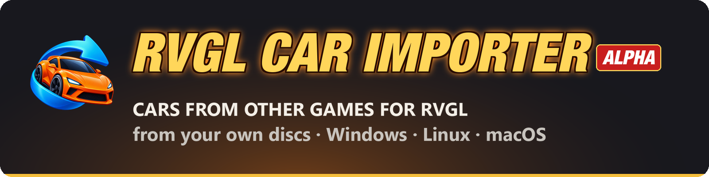
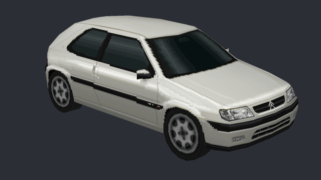
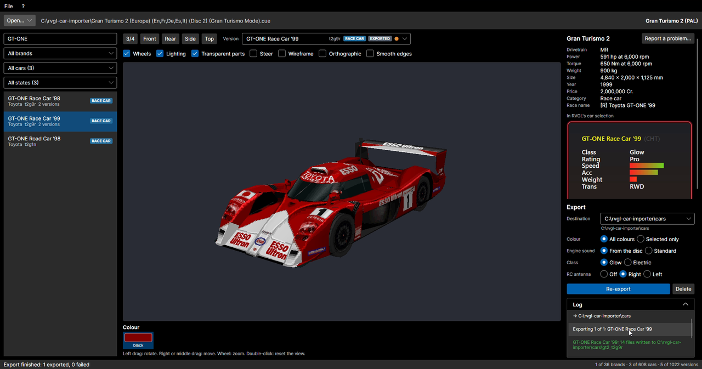
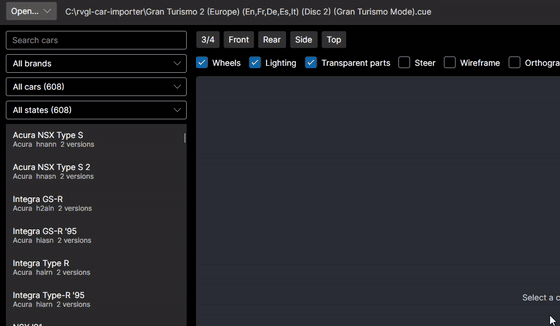
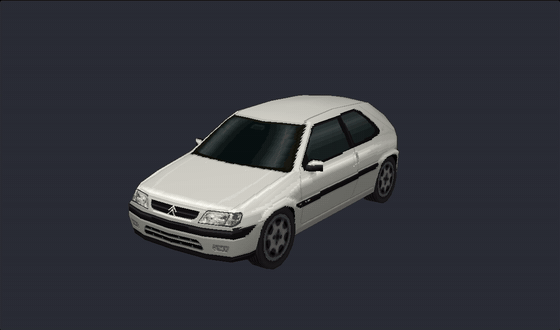
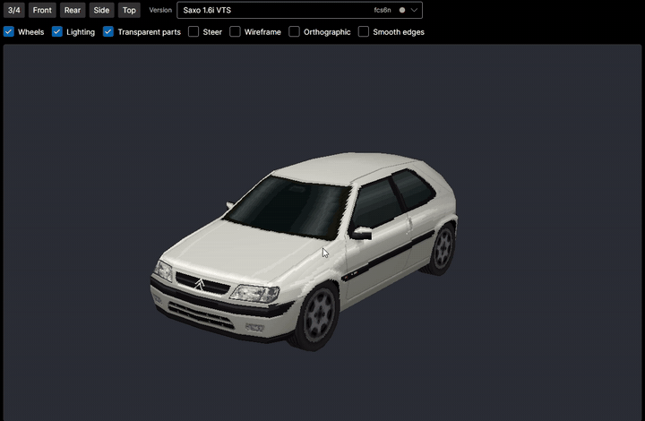
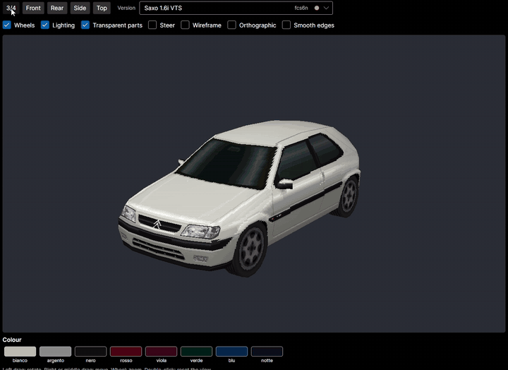
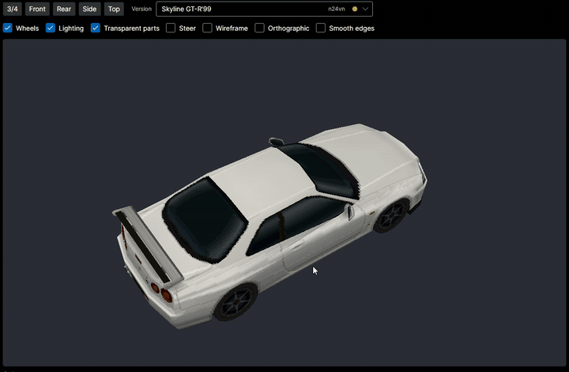
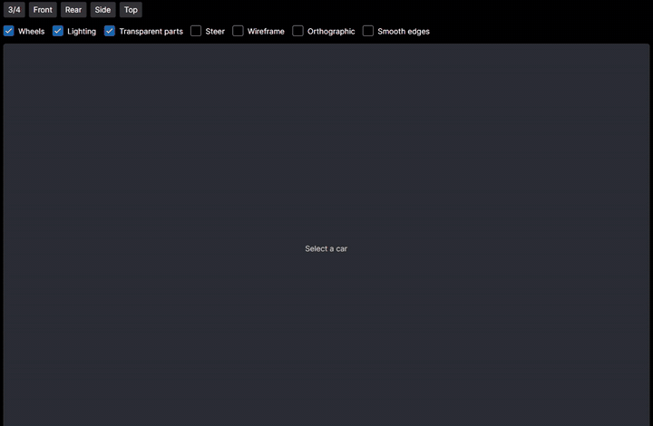
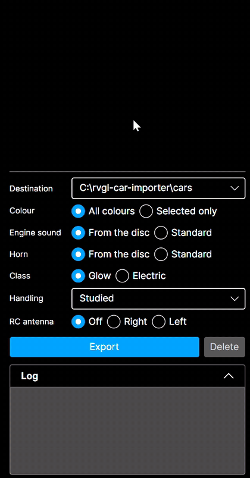

  
  
  
  
  

<b>Your own game disc in, RVGL cars out.</b> 
Read the disc, browse its cars, see each one exactly as RVGL will draw it, export it in one click.

  <a href="#-download"><b>Download</b></a> ·
  <a href="#-what-it-does"><b>What it does</b></a> ·
  <a href="#-supported-games"><b>Games</b></a> ·
  <a href="#-a-tour-of-the-app"><b>Tour</b></a> ·
  <a href="#-reporting-a-problem"><b>Report</b></a> ·
  <a href="#-faq"><b>FAQ</b></a>

## 🏁 What it does

<table>
  <tr>
    <td align="center" width="33%"><h3>💿 1. Open your disc</h3>A disc image (<code>.cue</code>/<code>.bin</code>, <code>.iso</code>, <code>.img</code>), the CD in the drive or a folder of the disc's files. The app ships no game data.</td>
    <td align="center" width="33%"><h3>🔍 2. Pick a car</h3>Every car on the disc, each in every version and colour the game has: <b>over 600 cars</b> from the supported games.</td>
    <td align="center" width="33%"><h3>🏎️ 3. Export to RVGL</h3>Body, colours, wheels, handling, engine sound, horn and the car's box in RVGL's menu, straight into its <code>cars</code> folder.</td>
  </tr>
</table>

## 🎮 Supported games

<table>
  <tr>
    <td width="33%" valign="top"><h3>Gran Turismo 2</h3>PlayStation · disc 2 · PAL, Japanese, USA v1.0, v1.1, v1.2  
      <b>608 cars</b> and <b>1,022 versions</b> on the PAL disc: road cars, racing modifications, JGTC GT500, Le Mans and rally cars.
      <ul>
        <li>every colour, with its name from the disc</li>
        <li>handling and stats bars ranked against RVGL's own cars, from the car's power, weight and top speed</li>
        <li>an engine sound made from the car's engine on the disc</li>
      </ul></td>
    <td width="33%" valign="top"><h3>RC Revenge</h3>PlayStation · USA  
      All <b>15 cars</b>, from Badd RC to the UFO, as the game draws them.
      <ul>
        <li><b>the game's own handling</b>: the physics is read from the game and brought to RVGL, so each car drives as it does in RC Revenge</li>
        <li>each car's own engine sound and horn, and the RC antenna where the game mounts it</li>
        <li>the UFO flies as Re-Volt's Probe UFO</li>
      </ul></td>
    <td width="33%" valign="top"><h3>RC Revenge Pro</h3>PlayStation 2 · USA  
      All <b>19 cars</b> in both their liveries: <b>38 versions</b>, from Badd RC Pro to Zany Zoomer Pro 2.
      <ul>
        <li><b>the game's own physics</b>, read from the game and brought to RVGL</li>
        <li>each car's own engine sound and horn, at the console's own rate</li>
        <li>the RC antenna, the see-through glass and Big Rock's dump bed</li>
      </ul></td>
  </tr>
</table>

More games are to come.

## 🎬 A tour of the app

<table>
  <tr>
    <td width="50%"></td>
    <td width="50%"><h3>Find any car</h3>Search by name, filter by brand, kind or state. Each car lists its versions; race cars carry their badge.</td>
  </tr>
  <tr>
    <td width="50%"><h3>See it as RVGL draws it</h3>A real-time viewer with RVGL's own look: drag to rotate, right-drag to move, wheel to zoom, double-click to reset.</td>
    <td width="50%"></td>
  </tr>
  <tr>
    <td width="50%"></td>
    <td width="50%"><h3>Every angle</h3>Three-quarter, front, rear, side and top in one click.</td>
  </tr>
  <tr>
    <td width="50%"><h3>Every colour</h3>All of a car's colours, with their names from the disc where the game has them; export them all or just one.</td>
    <td width="50%"></td>
  </tr>
  <tr>
    <td width="50%"></td>
    <td width="50%"><h3>Wireframe, lights, wheels</h3>Check every car before it races: wireframe, lighting, wheels, transparent parts, steering, orthographic view.</td>
  </tr>
  <tr>
    <td width="50%"><h3>Race cars too</h3>Gran Turismo 2's JGTC GT500, Le Mans and rally cars, each with RVGL's rating and stats bars shown as RVGL's car selection will show them.</td>
    <td width="50%"></td>
  </tr>
  <tr>
    <td width="50%"></td>
    <td width="50%"><h3>One-click export</h3>Choose the destination, the colours, the engine sound and the horn (from the disc or RVGL's standard), the class, the handling and the RC antenna; <b>Export</b> writes the car, the log tells you where.  <b>Handling</b>: the physics studied for the car, or the handling of any of the 49 original cars of Re-Volt and RVGL found in your RVGL, each shown in a picture; the car keeps its own body and wheels.</td>
  </tr>
</table>

## 📦 Download

No installer and nothing else to install: download the one file for your system and run it. Every file is in the [latest release](https://github.com/6up3r/rvgl-car-importer-releases/releases/latest).

| Your system | Download | First start |
| --- | --- | --- |
| **Windows 11**, or Windows 10 LTSC/Enterprise, 64-bit | [**win-x64.exe**](https://github.com/6up3r/rvgl-car-importer-releases/releases/latest/download/rvgl-car-importer-win-x64.exe) | If SmartScreen shows «Windows protected your PC», click **More info**, then **Run anyway** |
| **Windows 10 LTSC/Enterprise**, 32-bit | [**win-x86.exe**](https://github.com/6up3r/rvgl-car-importer-releases/releases/latest/download/rvgl-car-importer-win-x86.exe) | The same |
| **Windows 11 on ARM** | [**win-arm64.exe**](https://github.com/6up3r/rvgl-car-importer-releases/releases/latest/download/rvgl-car-importer-win-arm64.exe) | The same |
| **Linux**, x64 | [**linux-x64.AppImage**](https://github.com/6up3r/rvgl-car-importer-releases/releases/latest/download/rvgl-car-importer-linux-x64.AppImage) | Make it executable (`chmod +x`), then run it |
| **macOS 14+**, Apple Silicon | [**osx-arm64.zip**](https://github.com/6up3r/rvgl-car-importer-releases/releases/latest/download/rvgl-car-importer-osx-arm64.zip) | Unzip and open `RVGL Car Importer.app`. The app is not notarized, so macOS blocks it once: go to System Settings > Privacy & Security and click **Open Anyway** |
| **macOS 14+**, Intel | [**osx-x64.zip**](https://github.com/6up3r/rvgl-car-importer-releases/releases/latest/download/rvgl-car-importer-osx-x64.zip) | The same |

<b>Not sure which file you need?</b>

 

- **Windows**: Settings > System > About, «System type». «64-bit operating system, x64-based processor» takes `win-x64`, «32-bit operating system» `win-x86`, «ARM-based processor» `win-arm64`.
- **macOS**: Apple menu > About This Mac. «Chip: Apple M…» takes `osx-arm64`, «Processor: Intel» takes `osx-x64`.

<b>What Linux needs</b>

 

The libraries .NET lists for self-contained apps, which desktop distributions usually have already: `libc6`, `libgcc-s1`, `libstdc++6`, `libssl3`, `ca-certificates`, `tzdata`, `zlib1g`, `libgssapi-krb5-2`. Then X11 for the window and FUSE to mount the AppImage. Without FUSE, start it with `--appimage-extract-and-run`.

> [!TIP]
> The app updates itself: at start and from **File > Check for updates...** it looks for a newer release here, and after an update it shows once what is new (**? > What's new...** at any time). It installs a file only if its SHA-256 is listed in the release's `release.json`, signed with the authors' key (`release.json.sig`).

## 🛠️ Reporting a problem

With over 1,000 car versions, nobody can check them all by hand: your reports are how they get fixed. Before reporting:

- update the app (**File > Check for updates...**): the problem may already be fixed;
- look at the car in the app: a purple **REPORTED** tag means its problem is already known, and the issue is linked under the car's sheet. Report it again only if yours is a different problem.

### 🚗 A car looks or drives wrong

1. Open the car in the app and press **Report a problem...** next to its name.
2. The [car report form](https://github.com/6up3r/rvgl-car-importer-releases/issues/new?template=car.yml) opens with the car, the disc and the app's version already filled in.
3. Choose the category, say where it shows (in the app or in RVGL), describe what you see and attach a screenshot.

One report per car and per problem: two problems on one car are two reports.

### 💥 The app closed unexpectedly

1. Start the app again: it tells you where it saved the crash report.
2. Press **Report on GitHub**: the [crash report form](https://github.com/6up3r/rvgl-car-importer-releases/issues/new?template=crash.yml) and the report's folder open.
3. Drag the report file into the form and say what you were doing when it closed.

The report holds the app's version, the system and the error; your home folder is written `~`, so it carries no user name.

**What happens next:** the authors read every report and label the ones they accept. From then on the car shows **REPORTED** in everyone's app, and the fix comes in a later release, which the app installs itself.

## ❓ FAQ

<b>Does the app contain any game data?</b>

 
No. It reads your own copy of the disc, an image or the CD in the drive, and converts the cars on your computer.

<b>Which discs does it read?</b>

 

- **Gran Turismo 2**, disc 2: PAL (SCES-12380), Japanese (SCPS-10117), USA v1.0, v1.1 and v1.2 (SCUS-94488).
- **RC Revenge**, PlayStation: USA (SLUS-01168).
- **RC Revenge Pro**, PlayStation 2: USA (SLUS-20153).

«? > Compatible games» in the app lists them with their serials; a disc it does not read is refused with that list.

<b>Why does RVGL's box show other bars than the game?</b>

 
The box shows what RVGL will show, worked out from the car's parameters in RVGL: for an RC Revenge or RC Revenge Pro car the game's own handling, whose bars in the game are set by hand; for a Gran Turismo 2 car its rank among the game's road cars. Its tooltip in the app says which.

<b>Where does the app keep its settings and crash reports?</b>

 
In <code>settings.txt</code> of your application data folder (<code>%APPDATA%\rvgl-car-importer</code> on Windows, <code>~/.config/rvgl-car-importer</code> on Linux), the crash reports in its <code>crash</code> folder, the last 10.

<b>Where do the exported cars go?</b>

 
Into the <code>cars</code> folder you choose under <b>Export</b>, usually the one of your RVGL. «Delete» removes only cars this app exported.

 
Made by <b>6Up3r</b> · an alpha version: more games to come

